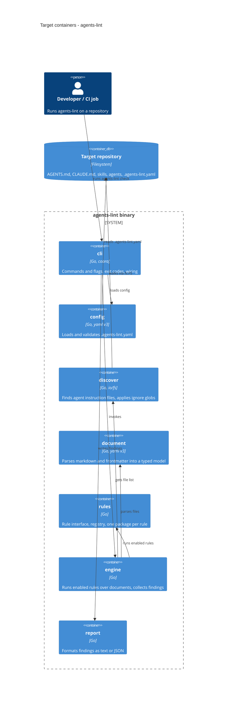

# Architecture map — agents-lint

> **Greenfield foundation** (`mode: greenfield-bootstrap`): this map fixes the **target baseline**
> decided in the `survey` foundation session on 2026-10-04 — nothing below exists in code yet.
> `/sdd:scaffold` materializes it from `docs/features/_scaffold/tasks.json`; once scaffolded, the
> paths below become real and a later `survey` re-stamps this map as `mode: current`.

**What it is:** `agents-lint` — a CLI linter for AI-agent instruction files (`AGENTS.md`,
`CLAUDE.md`, `.claude/skills/**/SKILL.md`, `agents/*.md`, commands, plugin manifests). It discovers
these files in a repo, parses markdown + YAML frontmatter into a typed model, runs a registry of
rules over them and reports findings (text / JSON, SARIF later) with a CI-friendly exit code.

## Stack

- Language / runtime: Go 1.26, single module `github.com/ingvar-goryainov/agents-lint` (`go.mod`, S1) — [ADR-0001](adr/0001-go-cobra-single-binary-cli.md)
- Frameworks: `spf13/cobra` (CLI), `go.yaml.in/yaml/v3` (config + frontmatter), stdlib for the rest; `rogpeppe/go-internal/testscript` (CLI e2e tests only)
- Build / test / lint: `go build ./...` · `go test -race ./...` · `golangci-lint run ./...` (v2 config `.golangci.yml`), wrapped as `make build|test|lint` (`Makefile`, S3)
- Distribution: single static binary; `go install` now, GoReleaser + GitHub Releases later (not part of the scaffold)

## C4 — target baseline

## Module inventory

Pipeline + rule registry ([ADR-0002](adr/0002-pipeline-with-rule-registry.md)): discover → parse → check → report.
All non-entry code lives under `internal/` (no public Go API promised yet).

| Module | Path | Layers | Wired at | Responsibility |
|---|---|---|---|---|
| entry | `cmd/agents-lint/` | main | `cmd/agents-lint/main.go` (S1) | `os.Exit(cli.Execute(ctx, os.Args[1:], stdout, stderr))` — nothing else |
| cli | `internal/cli/` | ports | `internal/cli/root.go` (S1) | cobra root + one file per subcommand (`check`, `rules`, `version`); maps results to exit codes |
| config | `internal/config/` | app | called from `internal/cli` | load `.agents-lint.yaml` (strict decode, `version: 1`), defaults, validation |
| discover | `internal/discover/` | infra | called from `internal/engine` | walk an `fs.FS`, classify files by kind (agents-md, claude-md, skill, agent, command, …), honor ignore globs |
| document | `internal/document/` | domain | — (pure) | typed model `Document{Path, Kind, Frontmatter, Body, Sections}` + parser with line/col positions |
| rules | `internal/rules/` + `internal/rules/<ruleid>/` | domain | `internal/rules/registry.go` (S1, empty) | `Rule` interface, `Finding`/`Severity` types, registry; each rule its own package with `testdata/` |
| engine | `internal/engine/` | app | called from `internal/cli` | orchestrates discover → parse → run rules → sort findings; no I/O of its own beyond `fs.FS` |
| report | `internal/report/` | ports | called from `internal/cli` | `text` and `json` formatters (SARIF later) writing to an `io.Writer` |

Scaffold creates `cmd/`, `internal/cli` (root + `version`), `internal/rules` (types + empty registry) and
the harness; the other packages are created by the first features that need them.

## Conventions (cited — the rules a new feature must match)

> Targets fixed by this foundation; files marked (S#) are created by that scaffold task.

- **Module wiring / registration:** rules self-describe (`ID()`, `Description()`, `DefaultSeverity()`, `Check(*document.Document) []Finding`) and are listed explicitly in `internal/rules/registry.go` (S1) — no `init()` side-effect registration, so the rule set is greppable and deterministic.
- **Rule purity:** a rule never touches the filesystem or globals — it sees only the parsed `Document` (plus repo-level context passed in by `engine`). Filesystem access is `discover`'s job, via `fs.FS` so tests use `fstest.MapFS`.
- **Error handling:** wrap with context `fmt.Errorf("load config %s: %w", path, err)`; sentinel errors (`var ErrX = errors.New(...)`) checked with `errors.Is`. **Lint findings are data, not errors** — `rules.Finding{RuleID, Severity, Path, Line, Col, Message}` (S1, `internal/rules/rule.go`).
- **Exit codes:** `0` clean · `1` findings at/above `--fail-on` severity (default `error`) · `2` usage / config / runtime error — defined once in `internal/cli/exit.go` (S1).
- **Output:** findings → stdout via `internal/report`; diagnostics/logs → stderr; output deterministic (findings sorted by path, line, col, rule ID).
- **IDs:** rule IDs are stable kebab-case strings (`skill-missing-description`), never renumbered; they are part of the public config contract.
- **Persistence / DB access:** none — stateless, no datastore ([ADR-0003](adr/0003-yaml-config-no-datastore.md)).
- **Configuration:** `.agents-lint.yaml` at the scanned root (or `--config`); `version: 1`; `rules: {<id>: {severity: off|info|warning|error, options: {...}}}`; `ignore: [globs]`; unknown keys are an error (strict decode). Config format is a public contract — breaking changes bump `version`.
- **Migrations:** N/A (no datastore).
- **Tests:** stdlib `testing`, table-driven, `t.Parallel()` where safe. Rules: fixtures in `internal/rules/<ruleid>/testdata/*.md` + golden expected findings (`*.golden`, regenerated with `go test ./... -update`; golden diffs are reviewed like code). CLI e2e: `testscript` scripts in `internal/cli/testdata/script/*.txtar` driven by `internal/cli/cli_test.go` (S2). Smoke test = `version.txtar` (binary boots, exits 0).
- **Inter-module communication:** direct function calls, dependency direction `cli → engine → {discover, document, rules}`, `cli → {config, report}`; `document` and `rules` import nothing internal except `rules → document`.
- **Lint / static analysis:** golangci-lint v2, `.golangci.yml` (S3) — `standard` set + `errorlint`, `gocritic`, `revive`, `misspell`, `gofumpt` formatter.
- **CI:** GitHub Actions `.github/workflows/ci.yml` (S4): `go build`, `go test -race`, golangci-lint on push + PR.
- **UI / styling:** N/A — no frontend.

## Datastores

| Store | Engine | Accessed via | Notes |
|---|---|---|---|
| (none) | — | — | Stateless CLI; the only inputs are files in the scanned repo + `.agents-lint.yaml` |

## Frontend / UI foundation

<!-- N/A: no frontend -->

## Where things live / closest precedents

- A new **lint rule** → `internal/rules/<ruleid>/rule.go` + `rule_test.go` + `testdata/`, one line in `internal/rules/registry.go`. First rule becomes the precedent for all others.
- A new **file kind** (e.g. Cursor rules, Copilot instructions) → a classifier entry in `internal/discover` + a `document.Kind` constant; parsing stays in `internal/document`.
- A new **subcommand** → `internal/cli/<name>.go` + a `.txtar` script; precedent `internal/cli/version.go` (S1).
- A new **output format** → `internal/report/<format>.go` implementing the reporter func; precedent the `text` formatter (first `check` feature).

## Constraints & known tech-debt

- Go ≥ 1.26 required (toolchain directive in `go.mod`).
- Rule IDs and the config schema are public contracts from the first release — no renames without deprecation.
- No public Go API: everything under `internal/` until a deliberate decision (would need an ADR) to expose a `pkg/` for third-party rules.
- No release pipeline in the scaffold — GoReleaser is a later feature.

## Reconciliation with the authored architecture doc

No authored architecture doc (README is a title only, no root `CLAUDE.md`, no prior ADRs); this map is the reference. Foundational ADRs: [0001](adr/0001-go-cobra-single-binary-cli.md), [0002](adr/0002-pipeline-with-rule-registry.md), [0003](adr/0003-yaml-config-no-datastore.md).
